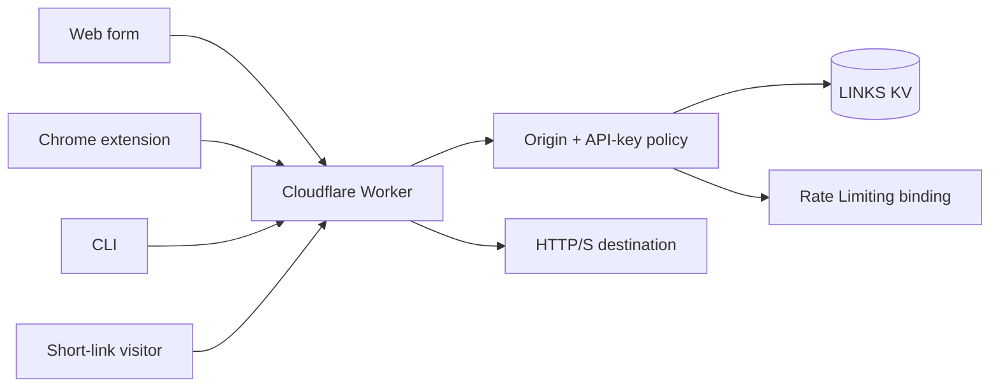

# Architecture

ABVX Shortener is one Cloudflare Worker with a KV namespace, a native rate-limiting binding, and three clients.

## Runtime boundaries

- `worker/src/index.ts` owns routing and HTTP behavior.
- `worker/src/auth/` authenticates keys, roles and browser origins.
- `worker/src/validation/` canonicalizes and validates target URLs.
- `worker/src/storage/` owns link records, audit events and telemetry.
- `extension/` and `bin/` are untrusted API clients; they never receive KV access.

## Storage model

Normal KV keys are slugs. System data uses reserved prefixes:

- `stats:` for legacy counters (read-only, no new samples);
- `evt:` for expiring audit events;
- `rl:` for the local fallback limiter used when the native binding is absent.

Redirect lookups are read-only, including expired and disabled links. No redirect writes to KV or schedules background bookkeeping. Link creation and management remain authenticated and write link records plus management audit events.

Metrics emit structured Workers Logs and, if provisioned separately, an optional `ANALYTICS` binding. Successful GET redirects emit one `redirect_hit`; HEAD probes do not count as clicks. Events count requests, including bots, rather than unique people. Telemetry failures cannot fail a redirect. Legacy `accessCount` and `lastAccessAt` fields are preserved but no longer updated. `/api/stats` exposes only explicitly incomplete legacy KV counters; use Logs or Analytics Engine for new events.

## Security invariants

- API secrets are Wrangler secrets and never committed configuration values.
- Browser origins are same-origin or explicitly allowed.
- Non-browser clients can be enabled independently.
- All target and fallback destinations must be public HTTP(S) URLs.
- Writer keys can modify only links they created; admin keys can manage all links.
- Token-bound private links are available to their creator and admins.
